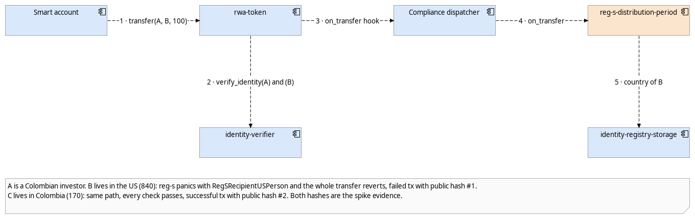

# RWAXI Platform

Real-world-asset security tokens on Stellar. The transfer rules run inside the token contract on every transfer, not in a database the operator can edit.

[](https://github.com/rwaxi/platform/actions/workflows/ci.yml)
[](LICENSE)

> **Status (October 2026): testnet spike deployed.**
> An OpenZeppelin RWA token on Stellar testnet with our Reg S compliance module. A transfer to a U.S. resident is rejected by the rule and a transfer between Colombian residents goes through. Reproduce both with one command.

This repository is meant to be read in order. Each step takes a couple of minutes.

## 1 · What RWAXI is and how to verify it

Every `transfer`, `mint` and `burn` checks the identity of both parties against on-chain claims and then runs the vehicle's compliance modules in the same transaction. If one check fails, everything reverts.



How the rule works: `reg-s-distribution-period` is a compliance module registered on the `CanTransfer` and `CanCreate` hooks. While the ledger sequence is below `period_end_ledger`, it answers `false` when the recipient's identity record shows a U.S. residence, and the token reverts with `TransferNotCompliant` (error 305). After that ledger it allows everything. Rule and rationale: [ADR-007](docs/6-decisions/ADR-007-spike-compliance-rule-reg-s.md).

**Verify it in two minutes.** Every contract below was deployed from the [`v0.1.1` release](https://github.com/rwaxi/platform/releases) artifacts, and Stellar Expert shows each one as a verified build of this repository (SEP-55). All addresses are in [`deployments/testnet.json`](deployments/testnet.json).

| Verify on Stellar testnet | Link |
|---|---|
| RWA token contract (`ABF1`) | [CDKWYFYW…KC7FLUIFH](https://stellar.expert/explorer/testnet/contract/CDKWYFYWDFH43BJ3SZBHQ3MCHZHUZFLUA2UE3KI3HN5R6UYKC7FLUIFH) |
| Compliance dispatcher | [CAXPI7GC…Y4Z6QZWNEM](https://stellar.expert/explorer/testnet/contract/CAXPI7GCY7ZZJ3CNIVQA5A76I6TYC6NBNS44M4USMBNG32Y4Z6QZWNEM) |
| Reg S module | [CDDOEBLE…MMX6BVOULQ](https://stellar.expert/explorer/testnet/contract/CDDOEBLE5NA65DIQIMRCJTHYDESMK5STN4WT3XLDAXQ3ENMMX6BVOULQ) |
| ✅ Transfer allowed (Colombia → Colombia) | [transaction ed49b5e9…ceba3fe](https://stellar.expert/explorer/testnet/tx/ed49b5e9d4d65f8d787c935e847fe967bf7c6a576b2231420cffe8d12ceba3fe) |
| ❌ Transfer blocked (Colombia → U.S. resident) | Rejected when the network simulates the transaction, so nothing is written to the ledger and there is no hash. The demo script prints the contract error `#305` and the module's `can_transfer → false`. |
| Try both in the browser, no wallet or sign-up | [rwaxi.github.io/platform/demo](https://rwaxi.github.io/platform/demo/) (simulations through the public testnet RPC; nothing is signed) |
| Reproduce both with one command | `./scripts/demo-blocked-transfer.sh` |

The blocked case is also covered by [integration tests](tests/integration/src/spike.rs) that assert error 305 on transfer and 306 on mint, the exact boundary ledger, and that forced transfers are exempt.

## 2 · The central decision → [Architecture overview](docs/2-overview.md)

Why the rules live in the token, what the spike covers, what the grant pays for (tranches T1 to T3) and what stays outside it.

## 3 · The system, from the outside in → [C4 model](docs/3-c4/1-context.md)

| | View | What it answers |
|---|---|---|
| 3.1 | [Context](docs/3-c4/1-context.md) | Who uses RWAXI and which outside systems we depend on |
| 3.2 | [Containers](docs/3-c4/2-containers.md) | What we deploy, where it runs and how the pieces talk |
| 3.3 | [Components](docs/3-c4/3-components.md) | The contracts of each vehicle, and how compliance and identity work |


## 4 · How it works in motion → [Critical flows](docs/4-flows.md)

Compliance-checked transfer (the spike), onboarding with passkey, subscription, distribution and lost-device recovery.

## 5 · Security → [Data flows and trust boundaries](docs/5-security.md)

Where each piece of data travels, where it is stored and which of the six trust boundaries it crosses. Input to the STRIDE threat model.

## 6 · Why we decided this way → [ADRs](docs/6-decisions/README.md)

ADR-001 to ADR-007, each with context, options and decision. ADR-007 is the Reg S rule of the spike.

## 7 · Where the diagrams come from → [Model and diagrams](docs/7-model/README.md)

One Archi model generates the twelve diagrams. Also here: the architecture PDF in [English](docs/7-model/RWAXI_Architecture_Diagrams.pdf) and [Spanish](docs/7-model/RWAXI_Arquitectura_Diagramas.pdf).

## 8 · Open source and program requirements

| File | |
|---|---|
| [LICENSE](LICENSE) | Apache-2.0 for contracts and SDK |
| [SECURITY.md](SECURITY.md) | How to report a vulnerability. Don't open public issues for them |
| [CONTRIBUTING.md](CONTRIBUTING.md) | How we work: branches, reviews, ADRs |
| [.github/](.github) | Code owners, PR and task templates |

## Build & test

```bash
cargo test --workspace                          # unit and end-to-end tests
cargo clippy --workspace --all-targets -- -D warnings
stellar contract build                          # WASM; plain `cargo build` is not enough (OpenZeppelin uses spec shaking v2)
./scripts/deploy-testnet.sh                     # full deployment from scratch, writes deployments/testnet.json
```

Needs Rust 1.98.1 (pinned in `rust-toolchain.toml`) and `stellar-cli` 28.1.0. CI runs the same steps and fails below 80 % line coverage.

## Spike and award

What exists today is the 2026 spike, funded by RWAXI: one token, one rule, the identity stack, and the evidence above. The financed work for 2027 (modular compliance per vehicle, subscriptions, distributions, smart accounts, backoffice, audit package) is described in the [architecture overview](docs/2-overview.md) and is not in this repository yet.

The identity and token contracts are adapted from OpenZeppelin's examples (MIT, see [NOTICE](NOTICE)). The Reg S module, the registry getters it depends on, the tests and the deployment tooling are ours.

## What comes next

- Test plan and compliance matrix, once securities counsel confirms the rules.

Built on [OpenZeppelin `stellar-contracts`](https://github.com/OpenZeppelin/stellar-contracts) (RWA module, smart accounts), Soroban, native USDC and OpenZeppelin Relayer.
