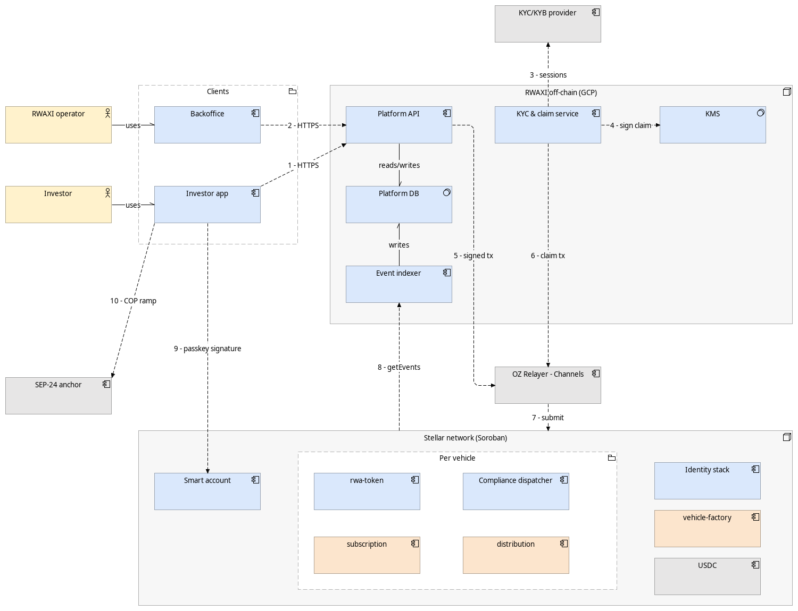

# RWAXI Platform

Regulated real-world-asset (RWA) security tokens on Stellar, with securities-law transfer rules enforced **inside the token contract** on every transfer, not in an off-chain database.

> **Status (Sept 2026): architecture published, testnet spike in progress.**
> The first milestone is `v0.1.0-spike`: an OpenZeppelin RWA token on Stellar testnet with a custom Reg S compliance module, one transfer blocked by the rule and one allowed, both with public transaction hashes.

## Verify on Stellar testnet

| What | Link |
|---|---|
| RWA token contract | _available with v0.1.0-spike_ |
| Compliance dispatcher + Reg S module | _available with v0.1.0-spike_ |
| ❌ Transfer blocked (US person during Reg S distribution compliance period) | _available with v0.1.0-spike_ |
| ✅ Transfer allowed | _available with v0.1.0-spike_ |
| Reproduce both with one command | `./scripts/demo-blocked-transfer.sh` (with v0.1.0-spike) |

## How compliance works

Every `transfer`, `mint` and `burn` on the token verifies the identity of both parties against on-chain claims and then runs the vehicle's compliance modules in the same transaction. If any check fails, the whole operation reverts.

## Architecture

| Document | |
|---|---|
| [Architecture overview](docs/architecture/README.md) | Scope, components by tranche, dependency inventory |
| [C4 context](docs/architecture/c4-context.md) · [containers](docs/architecture/c4-containers.md) · [components](docs/architecture/c4-components.md) | System structure |
| [Critical flows](docs/architecture/sequences.md) | Transfer, onboarding, subscription, distribution, recovery |
| [Data flow and trust boundaries](docs/dataflow.md) | Input to the STRIDE threat model |
| [Architecture Decision Records](docs/adr/README.md) | ADR-001 … ADR-007 |

Built on [OpenZeppelin `stellar-contracts`](https://github.com/OpenZeppelin/stellar-contracts) (RWA module, smart accounts), Soroban, native USDC and OpenZeppelin Relayer.

## License

Smart contracts and SDK are released under the [Apache License 2.0](LICENSE).

## Security

See [SECURITY.md](SECURITY.md). Do not open public issues for vulnerabilities.
