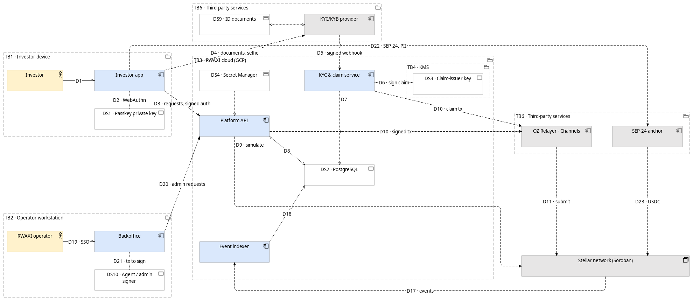
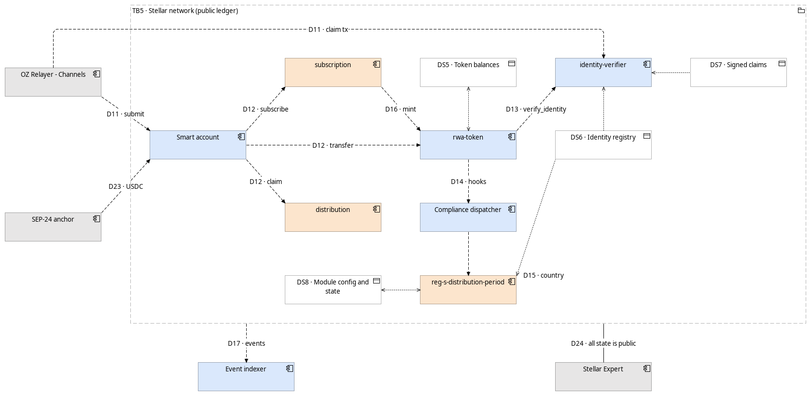
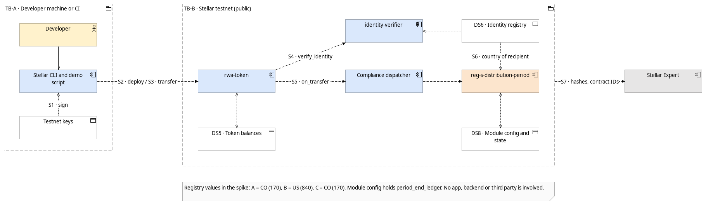

# 5 · Security: data flows and trust boundaries

> Status: **Draft v0.1** · 2026-09-24
> Purpose: answer *"What are we working on?"* in the Stellar threat-modeling process ([How-To Guide](https://developers.stellar.org/docs/build/security-docs/threat-modeling/threat-modeling-how-to)). This is the input to the STRIDE [threat model](threat-model.md) and to the [monitoring plan](monitoring.md), and it covers the "Dataflow Diagram" item of the Audit Bank readiness checklist.

Notation, as defined by the How-To Guide:

| Element | Meaning | Shape in the diagram |
|---|---|---|
| **External entity** | Outside RWAXI's control | grey rectangle |
| **Process** | Code or systems RWAXI controls | blue box (orange = RWAXI custom contract) |
| **Data store** | Where data is stored, including Soroban contract storage | white box with the data icon (`DSn`) |
| **Data flow** | Data moving between elements | numbered arrow `Dn` |
| **Trust boundary** | Group where trust assumptions change | dashed group labelled `TBn` |

---

## 1. System DFD (full platform, target architecture)

Split in two views so the flows stay readable. Flow IDs are shared between both views and the tables in §4. The three DFDs are views of the Archi model ([`7-model/rwaxi-architecture.archimate`](7-model/rwaxi-architecture.archimate)).

### 1a. Off-chain view (TB1–TB4, TB6)

### 1b. On-chain view (TB5)

---

## 2. Spike DFD (testnet evidence, October 2026)

The spike has no app, backend or third parties. A developer operates it with the Stellar CLI.

---

## 3. Trust boundaries

| ID | Boundary | What is trusted inside | Trust assumption crossing it |
|---|---|---|---|
| TB1 | Investor device | App code as shipped; the OS secure enclave | Nothing from the device is trusted by the backend or contracts without a passkey signature. The private key never leaves the enclave |
| TB2 | Operator workstation | The operator, authenticated via SSO + hardware key | Privileged on-chain actions need the agent/admin signer (multisig on mainnet); a backoffice session alone cannot move tokens |
| TB3 | RWAXI cloud | API, KYC service, indexer, DB | Requests from TB1/TB2 are untrusted input. The API is **not** in the trust path of compliance: anyone can call the contracts directly, so every rule is enforced on-chain |
| TB4 | KMS | Claim-issuer key; only the KYC service identity can request signatures | Compromise of this key = ability to issue false identity claims. Highest-value asset off-chain |
| TB5 | Stellar network | Contract code as deployed (verifiable via SEP-55 build attestation) and ledger state | Any account can invoke any contract function; authorization comes only from `require_auth` and RBAC. **Everything in TB5 is public** |
| TB6 | Third-party services | Each provider for its own function | KYC webhooks are authenticated and re-checked; the relayer can delay or censor but cannot forge signatures; the anchor handles its own PII and fiat |

---

## 4. Data flows

| ID | From → To | Data | Crosses | Protection |
|---|---|---|---|---|
| D1 | Investor → App | User input, biometric gesture | — | Biometric verified by the OS, never sent |
| D2 | App ↔ Passkey | WebAuthn challenge / signature | — (inside TB1) | Key non-exportable |
| D3 | App → API | Session token, requests, signed auth entries | TB1 → TB3 | TLS 1.2+, short-lived session bound to the passkey |
| D4 | App → KYC provider | ID documents, selfie (**PII**) | TB1 → TB6 | Provider SDK; RWAXI never receives the images |
| D5 | KYC provider → KYC service | Decision, country, investor type | TB6 → TB3 | Signed webhook, verified; decision re-fetched from provider API |
| D6 | KYC service ↔ KMS | Claim digest / signature | TB3 → TB4 | IAM: only the KYC service identity; every signature logged |
| D7 | KYC service → DB | KYC status, provider reference | — | No documents stored |
| D8 | API ↔ DB | Profiles, vehicles, indexed state | — | Private network, least-privilege DB roles |
| D9 | API → Soroban RPC | Transaction simulation | TB3 → TB5 | Read-only |
| D10 | API / KYC service → Relayer | Signed transaction XDR | TB3 → TB6 | Credentials in Secret Manager; payload already signed |
| D11 | Relayer → Stellar | Submission with fee bump | TB6 → TB5 | Signatures inside the transaction cannot be altered |
| D12 | Smart account → contracts | `transfer`, `subscribe`, `claim` | inside TB5 | `require_auth` via passkey signature |
| D13 | Token → Identity verifier | `verify_identity(from)`, `verify_identity(to)` | inside TB5 | Reverts if a required claim is missing, expired or revoked |
| D14 | Token → Compliance | `can_transfer` / `can_create` before the balances move; `transferred` / `created` / `destroyed` after | inside TB5 | Runs in the same transaction; one `false` makes the token revert with 305 or 306 |
| D15 | Reg S module → Identity registry | Country relations of the recipient | inside TB5 | Read-only |
| D16 | Subscription → Token | Mint at offering close | inside TB5 | Contract holds the agent role for minting only |
| D17 | Stellar → Indexer | Contract events | TB5 → TB3 | Public data; the indexer is **not authoritative**, the ledger is |
| D18 | Indexer → DB | Normalized state | — | Idempotent by ledger + event index |
| D19 | Operator → Backoffice | SSO session | inside TB2 | SSO + hardware key |
| D20 | Backoffice → API | Admin requests | TB2 → TB3 | Role checks in the API; audit log |
| D21 | Backoffice → Agent signer | Privileged transaction to sign | inside TB2 | Human review of the transaction before signing; multisig on mainnet |
| D22 | App → Anchor | SEP-24 interactive flow (**PII to anchor**) | TB1 → TB6 | Anchor's own KYC; RWAXI stores only the transaction reference |
| D23 | Anchor → Smart account | USDC | TB6 → TB5 | Standard SAC transfer |
| D24 | Ledger → Public | All on-chain state and events | TB5 → public | By design; see §5 on what is on-chain |

---

## 5. Data stores and classification

| ID | Store | Location | Data | Classification |
|---|---|---|---|---|
| DS1 | Passkey private key | Investor device, secure enclave | Signing key | **Secret** · never leaves the device |
| DS2 | PostgreSQL | TB3 | Name, email, KYC status, provider reference, indexed on-chain state | **Personal data** · encrypted at rest, backups with PITR |
| DS3 | Claim-issuer key | TB4 (KMS) | Ed25519 signing key | **Secret · critical** |
| DS4 | Secret Manager | TB3 | Relayer and provider API credentials | **Secret** |
| DS5 | Token storage | TB5 (Soroban) | Balances, frozen amounts, allowances | **Public · pseudonymous** |
| DS6 | Identity registry storage | TB5 (Soroban) | Wallet → identity contract, numeric ISO-3166 country codes and relation type | **Public · pseudonymous** — no names, no document numbers |
| DS7 | Identity claims | TB5 (Soroban) | Claim topic, issuer, signature, expiry | **Public · pseudonymous** |
| DS8 | Compliance module state | TB5 (Soroban) | Period end ledger, restricted relations, lock entries | **Public** |
| DS9 | Identity documents | TB6 (KYC provider) | Document images, liveness data | **Sensitive personal data** · governed by the provider agreement |
| DS10 | Agent / admin signer | TB2 (hardware key; multisig on mainnet) | Privileged signing keys | **Secret · critical** |

**Design rule:** no data that identifies a person by name or document ever reaches TB5. Linking a wallet to a person requires DS2 or DS9, both outside the public ledger.

---

## 6. Assumptions to validate

1. The KYC provider supports a client-side SDK, so documents go straight from device to provider (D4). If not, the flow changes and DS2 would temporarily hold documents.
2. Country codes on-chain (DS6) are acceptable to counsel from a privacy standpoint for the target jurisdictions (Colombia Law 1581, U.S.).
3. The relayer managed service (D10–D11) accepts signed Soroban invocations with smart-account auth entries.
4. The spike keys (TB-A) are testnet-only and are never reused on mainnet.

---

← [4 · Flows](4-flows.md) · [Index](README.md) · [Threat model](threat-model.md) →
