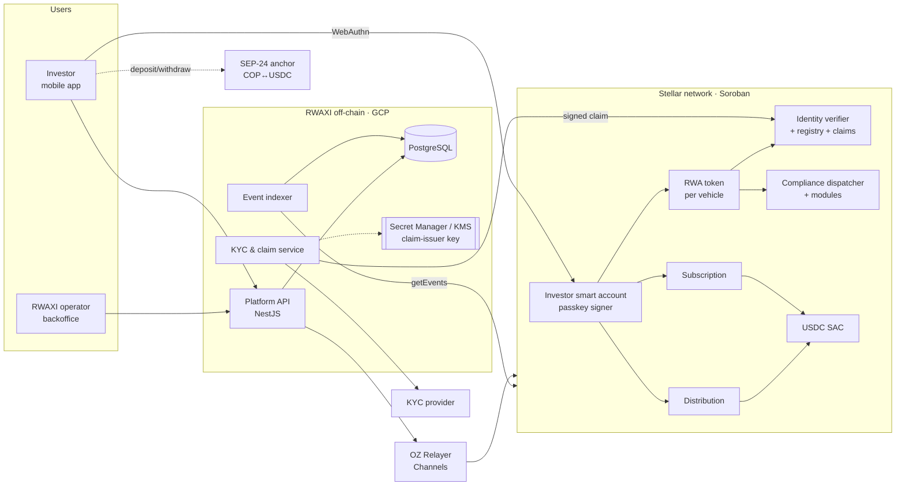

# RWAXI Platform — Architecture

> Status: **Draft v0.1** · 2026-09-24 · Owner: technical lead
> Scope: complete target architecture of the RWAXI platform on Stellar/Soroban, as required by SCF Build ("technical architecture must already be complete at the time of application").

## 1. What the system does

RWAXI issues and administers **regulated real-world-asset (RWA) security tokens** on Stellar. The first vehicle is **Avista Beach Tokenization Fund I** (12 land plots in Los Córdobas, Colombia; private fund regulated in the USA).

The core design principle: **securities-law transfer rules are enforced inside the token contract, on every operation, not in an off-chain database the operator can edit.** Each `transfer`, `mint` and `burn` is checked against the investor's on-chain identity claims and the vehicle's compliance modules in the same transaction. If any check fails, the whole operation reverts.

Stellar is the compliance and settlement layer of the product, not a storage add-on:

| Capability | Stellar primitive |
|---|---|
| Security token with transfer restrictions | Soroban contract on OpenZeppelin `stellar-contracts` RWA module (T-REX port) |
| Investor identity (KYC, accreditation, country) | On-chain identity registry + signed claims (OZ identity verification stack) |
| Walletless onboarding (no seed phrase) | Smart accounts with WebAuthn passkeys (secp256r1 verifier) |
| Investor never needs XLM | Fee sponsorship via OpenZeppelin Relayer + Channels |
| Subscription and distributions in dollars | Native USDC on Stellar (Stellar Asset Contract) |
| COP on/off-ramp | SEP-24 anchor (abstracted, not on the critical path) |

## 2. Documents

| Doc | Content |
|---|---|
| [c4-context.md](c4-context.md) | C4 Level 1 — system context, actors and external systems |
| [c4-containers.md](c4-containers.md) | C4 Level 2 — on-chain contracts, backend, apps, infra |
| [c4-components.md](c4-components.md) | C4 Level 3 — contract-by-contract and backend module breakdown, interfaces, roles |
| [../dataflow.md](../dataflow.md) | Data flow diagram and trust boundaries (threat-model input) |
| [sequences.md](sequences.md) | Critical flows: compliance-checked transfer, onboarding, subscription, distribution, recovery |
| [../adr/](../adr/README.md) | Architecture Decision Records ADR-001 … ADR-007 |

## 3. Scope boundaries

Three scopes must never be mixed, because SCF does not reimburse work done before the award.

| Scope | When | Funded by | What |
|---|---|---|---|
| **Spike** (evidence) | Oct 2026 | RWAXI, outside the award | One RWA token + minimal identity stack + compliance dispatcher + **one** custom module (Reg S distribution compliance period, [ADR-007](../adr/ADR-007-spike-compliance-rule-reg-s.md)). One blocked and one allowed transfer on testnet with public hashes. |
| **Award** (T1–T3) | Jan–Mar 2027 | SCF Build Award | Everything else in this document that is Stellar-integrated (see §5). |
| **Out of award** | Any | RWAXI | Institutional website, marketing, legal work, audits (Audit Bank), referral program, support tooling, AI assistant, IP registration. |

## 4. Architecture at a glance

## 5. Components by tranche

| Component | Spike 2026 | T1 · MVP (testnet) | T2 · Full product (testnet) | T3 · Mainnet |
|---|---|---|---|---|
| `rwa-token` (OZ RWA) | minimal | roles, pause, freeze, recovery, full tests | — | deployed + verified |
| Identity stack (registry, claim topics & issuers, claim issuer, verifier) | minimal, 1 topic | KYC + accreditation + country topics, expiry, revocation | — | deployed |
| Compliance dispatcher | yes | — | — | deployed |
| Module `reg-s-distribution-period` (custom) | **yes** | hardening + edge cases | — | deployed |
| OZ modules: `country_restrict`, `initial_lockup_period`, `max_balance`, `supply_limit` | — | configured per vehicle | — | deployed |
| `subscription` (custom) | — | — | USDC in → mint at close / refund | deployed |
| `distribution` (custom) | — | — | USDC deposit → pro-rata pull claim | deployed |
| `vehicle-factory` (custom) | — | — | one set of contracts per fund | deployed |
| Smart accounts (passkey) | — | onboarding + signed transfer | recovery signer | live |
| Fee sponsorship (OZ Relayer + Channels) | — | integrated | — | production plan |
| Platform API + KYC→claim service | — | yes | — | production |
| Event indexer | — | — | yes | production |
| Investor app | — | shell + onboarding | subscription + claim distributions | release |
| Backoffice | — | — | vehicle creation, claims, deposits | release |
| TS SDK (npm, Apache-2.0) | — | — | — | published |
| Threat model (STRIDE) + on-chain monitoring plan | — | — | **required by SCF in T2** | alerts live |
| Admin keys in multisig | — | — | — | yes |

## 6. Contract and dependency inventory

Versions must be pinned in `Cargo.toml` / `package.json`; this table is copied into the Build form.

| Dependency | Version (as of 2026-09-24) | Use |
|---|---|---|
| `soroban-sdk` | 27.0.2 (the version OZ 0.7.1 builds against) | all contracts |
| OpenZeppelin `stellar-contracts` (`stellar-tokens`, `stellar-access`, `stellar-accounts`, `stellar-contract-utils`) | 0.7.1 — re-evaluate 0.8.0 when it leaves RC | RWA token, identity, compliance, RBAC, smart accounts |
| Stellar CLI | pin at spike start | build, deploy, invoke |
| `@stellar/stellar-sdk` (TS) | pin at T1 start | backend, SDK |
| `stellar/smart-account-kit` (TS) | pin at T1 start | passkey smart accounts ([ADR-002](../adr/ADR-002-smart-accounts-passkeys.md)) |
| OpenZeppelin Relayer + Channels plugin | pin at T1 start | fee sponsorship ([ADR-003](../adr/ADR-003-fee-sponsorship-oz-relayer.md)) |
| USDC | Circle-issued, SAC on testnet / mainnet | subscription and distributions |

## 7. Cross-cutting concerns

**Roles and keys.** Every contract uses OZ RBAC. Separate roles: `admin` (config, upgrades), `agent` (mint, burn, freeze, recovery, forced transfer), `claim_signer` (identity claims), `module_operator` (compliance config). Testnet: single-key roles. Mainnet (T3): admin and agent behind a Stellar multisig account; the claim-signing key lives in cloud KMS and never touches code or CI.

**Privacy.** No personal data on-chain. The chain holds wallet ↔ identity-contract links, numeric ISO-3166 country codes, claim topics, issuer signatures and expiry. KYC documents stay with the KYC provider; PostgreSQL stores references only.

**Upgradeability.** Contracts are upgradeable by `admin` during testnet. For mainnet, upgrades go through the multisig with a published change log; the decision on a timelock is tracked as an open item.

**Observability.** The indexer consumes Soroban events (`transfer`, `mint`, `burn`, `frozen`, `recovery`, claim added/removed, compliance module changes, distribution deposit/claim). These feed product metrics, on-chain growth metrics for the SCF submission, and the T2 monitoring plan.

**Quality gates.** CI on every PR: `cargo fmt --check`, `cargo clippy -D warnings`, `cargo test`, coverage with `cargo-llvm-cov` (target ≥ 80 % on custom contracts), TS lint + tests, reproducible `stellar contract build`. Every testnet deploy records contract IDs and transaction hashes in `deployments/testnet.json`.

## 8. Open decisions

| # | Decision | Needed by | Owner |
|---|---|---|---|
| 1 | Final compliance rules per vehicle (countries, investor types, limits, lockups) from securities counsel | 2026-10-09 | RWAXI + counsel |
| 2 | SEP-24 anchor for COP: named partner vs. abstract interface (task 38) | 2026-10-11 | RWAXI + technical lead |
| 3 | Whether SCF applies jurisdiction-specific restrictions (testnet-only final tranche) | before tranche plan | RWAXI |
| 4 | Distribution snapshot mechanism: checkpoint module on compliance hooks vs. off-chain Merkle snapshot (see c4-components §2.8) | T1 kickoff | technical lead |
| 5 | Timelock on mainnet upgrades | T3 | technical lead |
