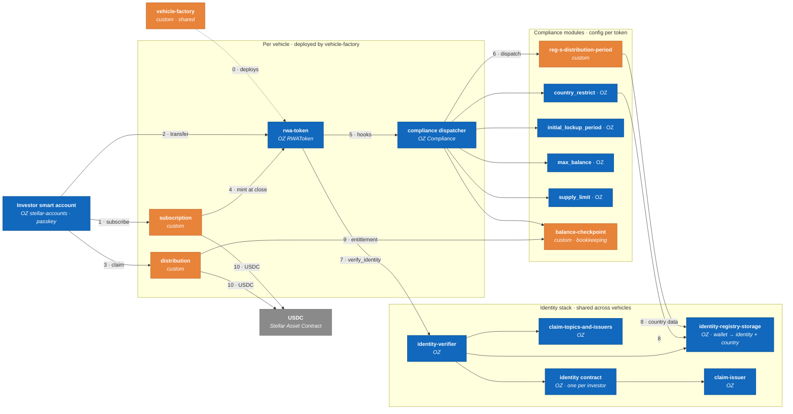

# C4 Level 3 — Components

## 1. On-chain component map

Legend: blue = OpenZeppelin `stellar-contracts` (configured), orange = RWAXI custom code, grey = external asset.

## 2. Contracts

### 2.1 `rwa-token` — OZ `RWAToken` (per vehicle)

Thin wrapper over OZ `stellar-tokens::rwa`. No custom token logic ([ADR-001](../adr/ADR-001-openzeppelin-rwa-module.md)).

| Function | Role | Notes |
|---|---|---|
| `transfer`, `transfer_from`, `approve`, `balance`, … | holder | SEP-41 surface; checks pause, freezes and free balance, verifies identity of `from` and `to`, then runs compliance `on_transfer` |
| `mint(to, amount, operator)` | agent | Called by `subscription` at close; triggers `on_created` |
| `burn(user, amount, operator)` | agent | Redemptions; triggers `on_destroyed` |
| `forced_transfer(from, to, amount, operator)` | agent | Court orders; `TransferKind::Forced` — policy modules exempt |
| `recover_balance(old, new, operator)` | agent | Lost device; `TransferKind::Recovery` — lock state moves with the investor |
| `set_address_frozen`, `freeze_partial_tokens` | agent | Regulatory freezes |
| `pause` / `unpause` | admin | Emergency stop |
| `set_compliance`, `set_identity_verifier` | admin | Wiring; emits events monitored in T2 |

Compliance model (from OZ): hooks run **after** state changes within the same transaction; a module rejects by panicking, which reverts everything. Each hook receives `AccountSnapshot { balance, frozen }` from before the operation, so modules never call back into the token.

### 2.2 Identity stack — OZ `identity_verification` (shared)

| Contract | Holds | RWAXI configuration |
|---|---|---|
| `claim-topics-and-issuers` | Required topics per token; trusted issuers per topic | Topics: `1 KYC`, `2 AML`, `3 ACCREDITATION` (US investors), `4 NON_US_PERSON` (Reg S). Trusted issuer at launch: RWAXI claim issuer only |
| `claim-issuer` | Public key(s) and revocation list | Ed25519 key in KMS; claims carry expiry |
| `identity` (per investor) | Signed claims | Created by KYC service at approval |
| `identity-registry-storage` | wallet → identity, `IdentityType`, `CountryData` list | `Residence(iso)`, `Citizenship(iso)`, `TaxResidency(iso)` — ISO-3166 numeric (US = 840, CO = 170) |
| `identity-verifier` | Orchestration | `verify_identity(account)` panics if a required topic has no valid claim |

One investor may hold several wallets (e.g., after recovery); identity is per investor, country data per wallet, as OZ models it.

### 2.3 Compliance dispatcher — OZ `Compliance` (per vehicle)

Registers modules per hook (`Transferred`, `Created`, `Destroyed`) and fans calls out. Only `module_operator` can add/remove modules. Every change emits an event that the monitoring plan alerts on.

### 2.4 Compliance modules

| Module | Source | Hook(s) | Rule | Vehicle I config (pending counsel, 2026-10-09) |
|---|---|---|---|---|
| `reg-s-distribution-period` | **custom** ([ADR-007](../adr/ADR-007-spike-compliance-rule-reg-s.md)) | Transferred, Created | Until `period_end_ledger`, no tokens may reach a wallet whose identity has a US country relation | Period length set by counsel |
| `country_restrict` | OZ | Transferred, Created | Blocks recipients from listed countries | OFAC-sanctioned jurisdictions |
| `initial_lockup_period` | OZ | Created, Transferred, Destroyed | Minted tokens locked N ledgers; only unlocked balance is movable | Holding period set by counsel |
| `max_balance` | OZ | Transferred, Created | Max holding per identity | Per offering memorandum |
| `supply_limit` | OZ | Created | Cap on total issuance | Fund size |
| `balance-checkpoint` | **custom** (T2) | all | Bookkeeping only: records per-holder balance at each distribution epoch | Used by `distribution` |

Rule source of truth: `docs/compliance-matrix.md` maps **legal rule → module → parameter → test**. No rule is implemented without a line in that matrix.

### 2.5 `subscription` (custom, per vehicle, T2)

- `open(window, min_ticket, soft_cap, hard_cap)` — admin
- `subscribe(investor, usdc_amount)` — requires `verify_identity(investor)` and window open; transfers USDC into escrow
- `close()` — if soft cap reached: mints tokens to each subscriber (compliance hooks apply to every mint) and releases USDC to the vehicle treasury; else enables `refund(investor)`
- Events: `subscribed`, `closed`, `refunded`

### 2.6 `distribution` (custom, per vehicle, T2)

- `deposit(usdc_amount)` — agent; opens epoch `n`, freezes the checkpoint
- `claim(investor, epoch)` — pull; amount = `deposit × balance_at_checkpoint / supply_at_checkpoint`; double-claim reverts
- Pull model chosen for fee cost and because compliance (freeze, identity validity) is re-checked at claim time.
- Open decision #4: checkpoint via the `balance-checkpoint` module (fully on-chain, preferred) vs. off-chain Merkle snapshot (cheaper, needs trust in the snapshot).

### 2.7 `vehicle-factory` (custom, shared, T2)

`create_vehicle(params)` deploys token + dispatcher + subscription + distribution with deterministic salts, registers the configured modules, binds the token to the shared identity stack and emits `vehicle_created` with every address.

### 2.8 Investor smart account — OZ `stellar-accounts` (per investor, T1)

- Signers: WebAuthn passkey (secp256r1 verifier) as primary; RWAXI recovery signer restricted by a policy to the recovery flow only.
- Created and sponsored by the backend at onboarding; the investor never holds XLM.
- The smart-account address is the wallet registered in `identity-registry-storage`.

## 3. Backend components (NestJS)

| Module | Responsibility | Talks to |
|---|---|---|
| `auth` | WebAuthn registration/assertion, session tokens | app, smart-account-kit |
| `accounts` | Deploy smart account, sponsor reserve | Relayer |
| `kyc` | Create provider session, receive webhook, map result → topics + country data | KYC provider |
| `claims` | Sign claim in KMS, `add_identity`, `add_claim`, revocation on expiry/AML hit | KMS, identity stack |
| `tx-builder` | Build and simulate Soroban transactions; return unsigned XDR / auth entries | Soroban RPC |
| `submit` | Forward signed transactions to OZ Relayer Channels; track status | Relayer |
| `vehicles` | Backoffice operations: factory, module config, mint, deposit | contracts |
| `indexer` | `getEvents` cursor → Postgres; exposes metrics | RPC, DB |
| `ramp` | SEP-24 interactive URL, status polling ([ADR-004](../adr/ADR-004-usdc-and-sep24-anchor.md)) | anchor |

## 4. Error model

Contract errors are numeric `#[contracterror]` codes. The SDK maps them to typed errors; the app shows a plain-language reason (e.g., *"This transfer is not allowed: the recipient is a US person during the Reg S distribution compliance period."*). Codes are documented in `docs/errors.md` and in each contract README.
