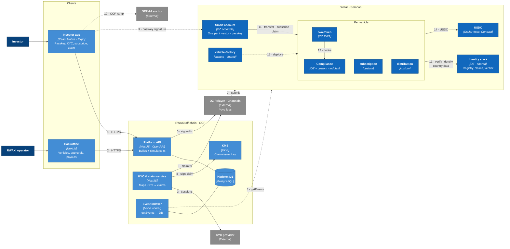

# C4 Level 2 — Containers

## Container responsibilities

### On-chain

| Container | Owner code | Shared or per vehicle | Key rule |
|---|---|---|---|
| `rwa-token` | OZ `RWAToken` + thin RWAXI wrapper | per vehicle | Every transfer/mint/burn calls identity verifier and compliance; failure reverts atomically |
| Identity stack | OZ examples, configured | **shared** (one investor, one identity, many vehicles) | Only RWAXI's claim issuer is trusted at launch; topics: KYC, accreditation, AML |
| Compliance dispatcher | OZ `Compliance` | per vehicle | Modules registered per hook; config only by `module_operator` |
| Compliance modules | OZ + custom `reg-s-distribution-period` | module contracts shared, config per token | Policy modules exempt `Forced`/`Recovery` transfers; bookkeeping still runs |
| `subscription` | custom | per vehicle | Accepts USDC only from identity-verified accounts, within window and caps |
| `distribution` | custom | per vehicle | Pull model; entitlement = holdings at the distribution checkpoint |
| `vehicle-factory` | custom | shared | Deterministic salts; emits event with all addresses of the new set |
| Smart account | OZ `stellar-accounts` | per investor | Passkey (secp256r1) signer; RWAXI recovery signer limited by policy to `recover_balance` flow |

### Off-chain

| Container | Stateless? | Scaling | Notes |
|---|---|---|---|
| Platform API | yes | Cloud Run autoscale | Never holds investor keys; builds unsigned transactions and simulates them |
| KYC & claim service | yes | Cloud Run | Only component that can call the KMS signing key |
| Event indexer | cursor in DB | single worker + standby | Idempotent upserts by ledger + event index |
| PostgreSQL | — | Cloud SQL, PITR | No KYC documents stored |
| SDK | — | npm | Generated bindings (`stellar contract bindings typescript`) + helpers |

## Environments

| Env | Network | Purpose |
|---|---|---|
| `local` | Stellar quickstart container | Unit/integration tests in CI |
| `testnet` | Stellar testnet | Spike evidence, T1–T2 deliverables, public demo for reviewers |
| `mainnet` | Stellar pubnet | T3 launch |

Testnet is periodically reset by SDF; `scripts/deploy.sh` redeploys the full set from scratch and `deployments/testnet.json` keeps historical hashes and screenshots (see task 26 contingency plan).
