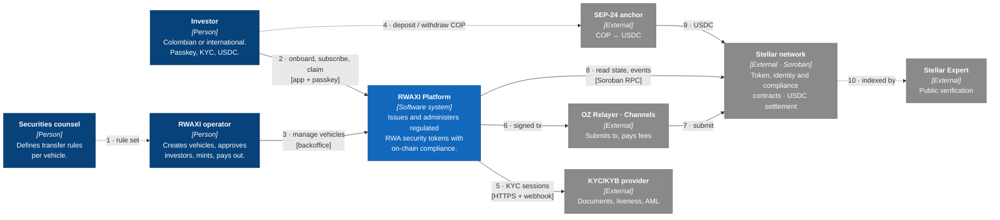

# C4 Level 1 — System Context

Legend: dark blue = people, blue = RWAXI, grey = external systems. Dotted lines are indirect or off-system relations.

## Actors

| Actor | Interacts through | Trust level |
|---|---|---|
| Investor | Mobile app + passkey on device | Untrusted input; every action is authorized by their smart account and checked by the token's compliance hooks |
| RWAXI operator | Backoffice (SSO + hardware key) | Privileged; mainnet actions via multisig |
| Securities counsel | Written rule set → operator configures modules | Source of truth for rules; never writes to the system directly |

## External systems

| System | Why it is external | Failure impact | Fallback |
|---|---|---|---|
| Stellar / Soroban RPC | Settlement layer | Platform read-only | Second RPC provider |
| KYC provider | Regulated identity verification | No new onboarding; existing holders unaffected | Provider abstraction in KYC service |
| OZ Relayer · Channels | Fee sponsorship | Investors cannot submit | Self-hosted OZ Relayer (same API) |
| SEP-24 anchor | Licensed fiat rails | No COP ramp; USDC deposits still work | Direct USDC deposit |
| Stellar Expert | Public verification | None on operations | Stellar Lab / RPC queries |

## What is deliberately **not** in the system

- No custody of investor keys: passkeys stay in the device secure enclave.
- No fiat handling: fiat enters and leaves only through a licensed anchor.
- No personal data on-chain.
