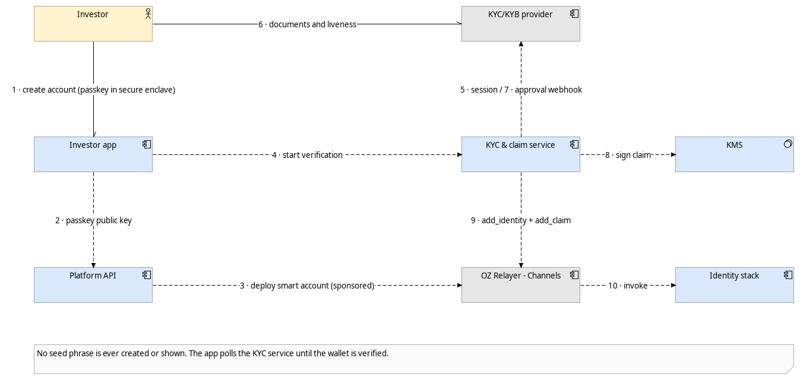
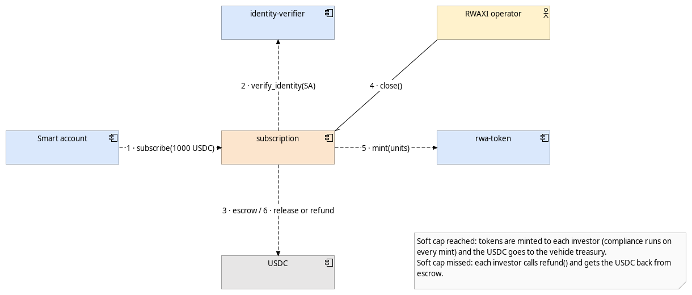
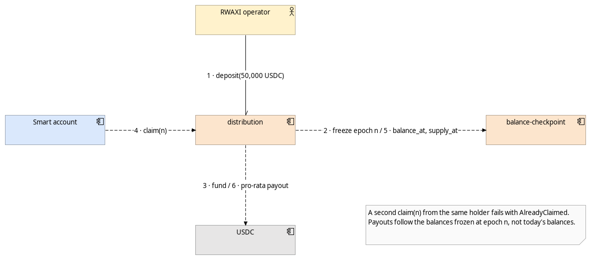
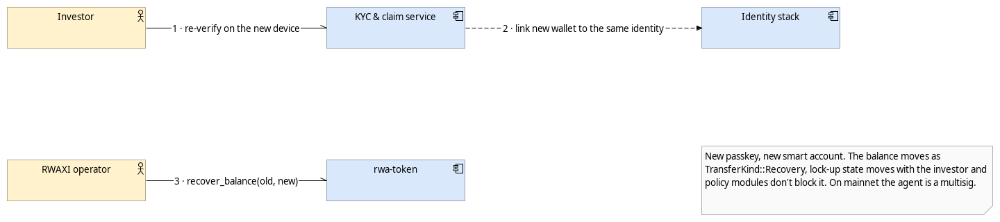

# Critical Flows

Five flows that matter for the product, each drawn as a view in the Archi model ([`archi/rwaxi-architecture.archimate`](archi/rwaxi-architecture.archimate)). Arrows are numbered in the order things happen. When the same pair of components talks twice, both steps share one arrow (for example `5 · session / 7 · approval webhook`).

## 1. Compliance-checked transfer (spike evidence)

This is the claim of the whole application, so it is also what the spike proves on testnet. A Colombian investor sends tokens to a US resident during the Reg S distribution period. The token checks both identities, fires the hook, and our Reg S module reads the recipient's country and panics. Everything reverts and the failed transaction stays on Stellar Expert. The same transfer to a Colombian recipient goes through.

The rule doesn't depend on our database, our API or the wallet the investor uses. Any path to the token goes through the same hook.

## 2. Onboarding: passkey, KYC and on-chain claim

The account is created with a passkey on the phone and the smart account is deployed with a sponsored fee, so the investor never sees a seed phrase or needs XLM. Documents go straight from the phone to the KYC provider. We only get the decision, sign a claim with the key in KMS and write it to the identity stack.

## 3. Subscription (T2)

`subscription` only takes USDC from verified accounts and keeps it in escrow. At close, if the soft cap was reached it mints the tokens (each mint goes through compliance) and releases the USDC to the vehicle. If not, every investor can call `refund()` without asking anyone.

## 4. Distribution (T2)

Payouts use a pull model. The operator deposits the USDC, `balance-checkpoint` freezes balances for that epoch, and each holder claims their pro-rata share. Paying on frozen balances avoids the classic problem of someone buying the day before the payment to collect it.

## 5. Lost device recovery

Losing the phone doesn't lose the investment. The investor verifies again on the new device, the new wallet is linked to the same identity and the agent moves the balance with `recover_balance`. On mainnet that agent is a multisig, not one person.
