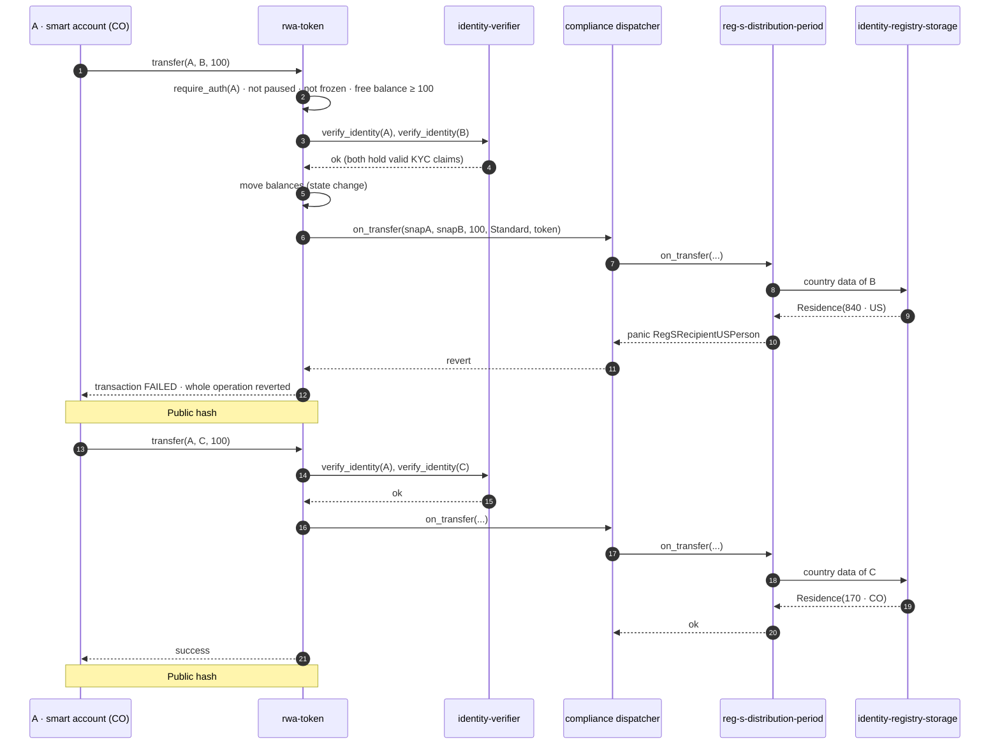
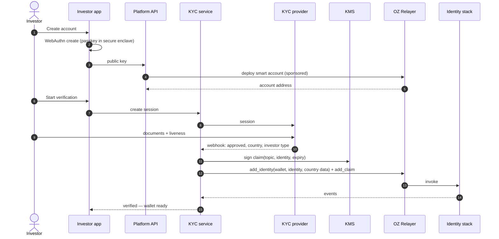
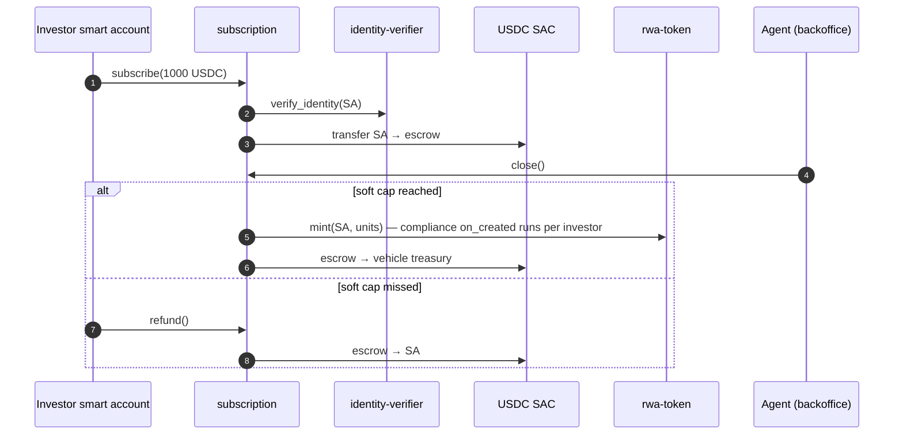
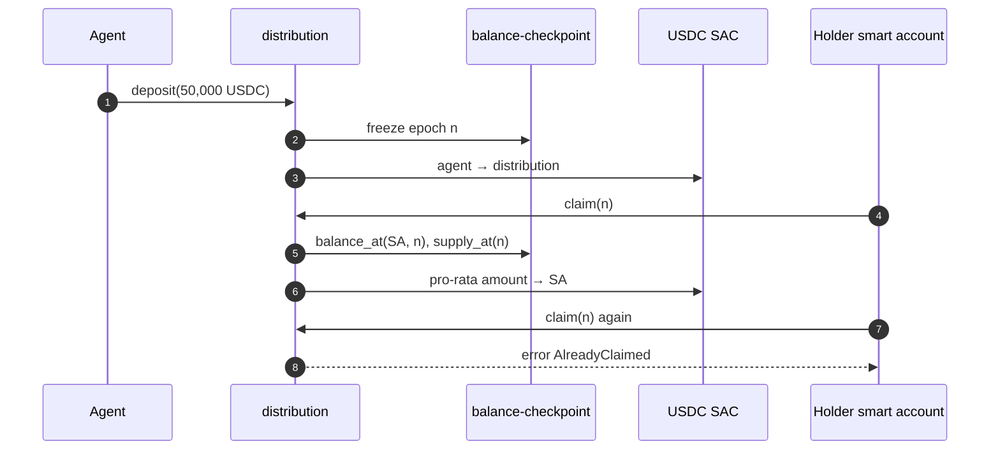
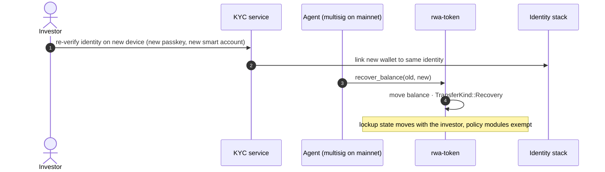

# Critical Flows

## 1. Compliance-checked transfer (the core claim — spike evidence)

Investor A (Colombia, Reg S purchaser) tries to send tokens to B (US resident) during the Reg S distribution compliance period, then to C (Colombia).

Why it matters: the rule cannot be bypassed by the operator's database, the API or a third-party wallet — any path to the token hits the same hook.

## 2. Onboarding: passkey → KYC → on-chain claim

No seed phrase is ever created or shown.

## 3. Subscription (T2)

## 4. Distribution (T2)

## 5. Lost device recovery

